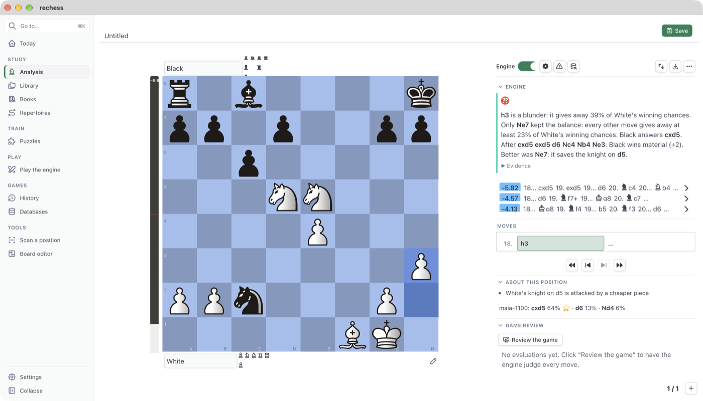
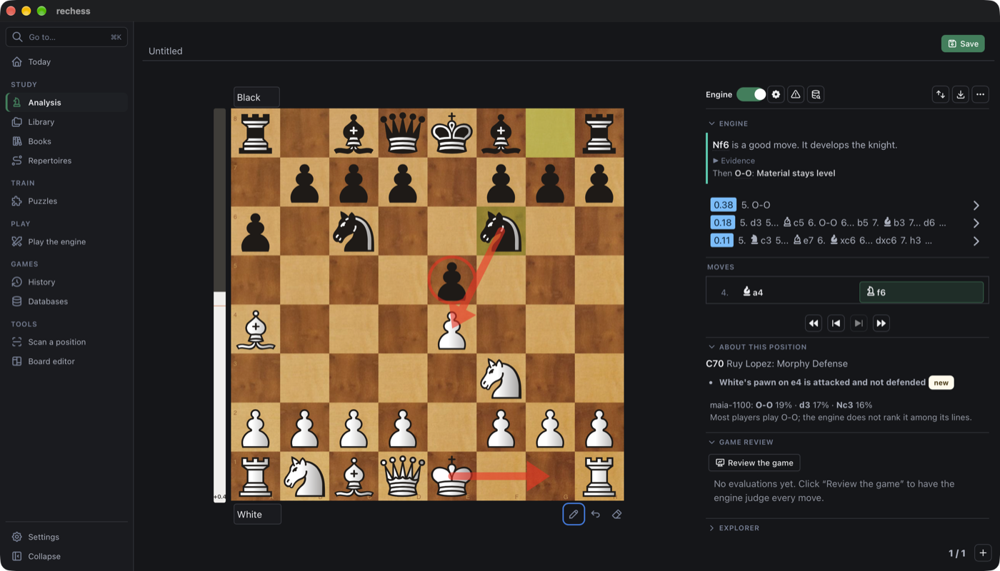

# Plybook

**A free desktop app for studying chess: analyse your games, find out *why* a move is good or
bad, and train on your own mistakes.** For macOS, with Windows following.



Most analysis tools tell you a move is a blunder and show the engine's line. Plybook also tells
you why, in words: what the move allowed, what the better move did, the tactic behind it, and
whether it was the only good move. Every claim comes from the engine's lines and the position
on the board, and it says when it is only an interpretation.

## What it does

**Analyse and understand**
- Analysis with any UCI engine (Stockfish, Lc0): several lines, an evaluation bar, the
  opponent's threat, endgame tablebases.
- Explanations in plain words, from the engine's lines and the board:
  - forks, pins and skewers;
  - threats stopped and created;
  - sacrifices;
  - "the only move";
  - positional ideas such as a bad bishop, holes, space, prophylaxis and king activity in the
    endgame.
- Human moves: what players of your level would play here, with the Maia networks for Lc0.
- Opening names and an opening explorer: your own game databases, opening books, and Lichess
  online.

**Review your games**
- Import your games from chess.com and Lichess, and keep them in sync.
- A full review of each game, in the background if you like:
  - accuracy, mistakes and blunders, the key moments;
  - book moves left out;
  - accuracy by phase (opening, middlegame, endgame) over your recent games.
- Your mistakes become puzzles, repeated until you know them.

**Train**
- The Lichess puzzle database, at your rating and by theme.
- Opening repertoires with spaced repetition.
- Play the engine at any strength, with clocks and an opening book, or with a tutor that
  explains as you play.
- "Guess the move" through any game: name up to three candidates, then see the game's move,
  the engine's best and how close you came.

**Read and organise**
- A library of your PGN files and game databases, with search by player, opening or position.
- Read chess books as PDFs with every diagram clickable, scan a position from a screenshot or
  the screen, and attach YouTube videos to positions.
- Annotate games: comments, variations, arrows and circles (with a pen for touchpads), and
  export a position or a game as an image or an animated GIF.

**Make it yours**
- Board colours, 18 wood, marble and other textures, and more than 30 piece sets; add your own.
- Light, dark and other app themes, an accent colour, and themes you can share as files.
- Keyboard shortcuts for everything, a command palette (⌘K), backups, and automatic updates.



## Install

Download the latest version from the [Releases](https://github.com/Canna71/rechess/releases)
page: a `.dmg` for macOS (Apple silicon or Intel) or an installer for Windows. Windows may warn
on a first install, because the installer is not code-signed.

Plybook does not include a chess engine. To analyse:
1. Download [Stockfish](https://stockfishchess.org/download/).
2. In Plybook, open Settings → Engines → **Add engine…** and choose it.

For human-like moves, add [Lc0](https://lczero.org/) with a
[Maia](https://maiachess.com) network.

Optional:
- **Lichess puzzles:** download them from the Puzzles page.
- **Your games:** add your chess.com or Lichess account in Settings → Accounts.
- **Opening book:** make one in Settings → Opening books from any PGN of games, such as a month
  of the [Lichess database](https://database.lichess.org).

Everything stays on your computer: your games, puzzles and notes are files and a local
database, and API keys go to the system keychain.

The [user guide](docs/GUIDE.md) explains every screen. The app has the same guide under
**Help**, and **F1** opens the part for the screen you are on.

## Build from source

```bash
pnpm install
pnpm tauri dev
```

You need Node 22, pnpm 10, Rust 1.97 or newer, and a C compiler: the Xcode command line tools
on macOS, or the MSVC build tools on Windows. [docs/DEVELOPMENT.md](docs/DEVELOPMENT.md)
covers the rest:
- checks, signing and releases;
- how the code is organised;
- design notes on explanations and position scanning.

The plan is in [docs/ROADMAP.md](docs/ROADMAP.md).

## Credits and licence

Plybook is free software under the **GPL-3.0-or-later** (see [`LICENSE`](LICENSE)). It builds on
the work of the Lichess community and others:
- **chessground and chessops** (GPL-3.0) for the board and the rules.
- **shakmaty and pgn-reader** (GPL-3.0) on the Rust side.
- **Stockfish, Lc0 and Maia:** you install them yourself, and they keep their own licences.
- **Piece sets:** each keeps its own licence (GPL, AGPL, MIT, Apache, Creative Commons). Some are
  for non-commercial use only. Authors and licences are in
  [`src/assets/styles/pieces/README.md`](src/assets/styles/pieces/README.md).
- **Board textures:** Lichess's (AGPLv3+), credited in
  [`public/boards/README.md`](public/boards/README.md).
- **Opening names** from [lichess-org/chess-openings](https://github.com/lichess-org/chess-openings)
  (CC0).
- **Puzzles and game data** from the [Lichess database](https://database.lichess.org) (CC0),
  downloaded on your request.
