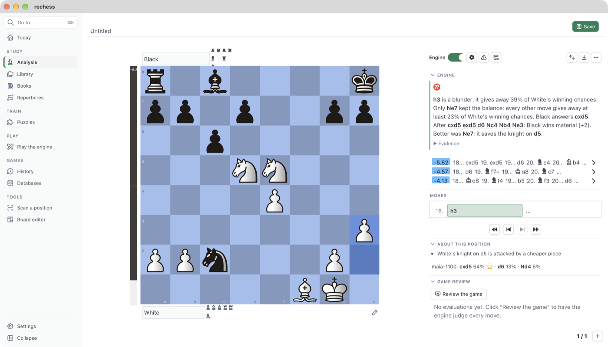

# Plybook user guide

This guide covers each screen in Plybook: what it is for and how to use it. The app has the same
text under **Help** in the sidebar. Most screens also have a **?** button in the header that
opens their section here, and **F1** opens it from anywhere.

## Getting started
<!-- help: start -->

Plybook does not include a chess engine, so start by adding one:

1. Download [Stockfish](https://stockfishchess.org/download/).
2. In Plybook, open **Settings → Engines → Add engine…** and choose the file you downloaded.

The **Get started** list on Today shows what else is worth setting up. Each step links to the
place where you do it:
- **Link your chess.com or Lichess account** (Settings → Accounts): your games come into the
  Library, ready to review.
- **Download the Lichess puzzles** (Puzzles): millions of tactics, picked at your rating.
- **Make an opening repertoire** (Repertoires): drill your lines with spaced repetition.
- **Add a chess book** (Library or Books): read a PDF with every diagram clickable.

Two ways to get around quickly:
- **⌘K** (Ctrl+K on Windows) opens **Go to…**: type a few letters of a screen, a setting, an
  action or a Library file.
- **⌘V** outside a text field opens what you pasted. A screenshot of a board is scanned for its
  position. A FEN, a PGN, a Lichess game link or a Chessable lesson's JSON opens in Analysis.

## Today
<!-- help: today -->

Today is the start screen. It shows what is waiting for you:
- **Openings:** repertoire moves due for review.
- **Puzzles:** your rating and a link to the next puzzle.
- **Mistakes:** puzzles made from your own reviewed games.
- **Continue:** the game or book you had open last.
- **Recent games** and **New online games:** games synced from your accounts, reviewed in the
  background when that is turned on.
- **Accuracy by phase:** how well you play the opening, middlegame and endgame across your
  recent reviewed games.

**Hide** removes the Get started list once you no longer need it.

## Analysis
<!-- help: analysis -->

Analysis is a board with an engine, the moves of the game, and explanations. It opens empty from
the sidebar, or with a game from the Library, a database, History or a paste.

**Moving around the game**
- Play moves on the board. A move that differs from the game's starts a variation.
- Use the arrows under the board, or the keyboard: ← and → for one move, ↑ and ↓ for the start
  and the end of the line. **?** lists every shortcut.
- Click a move in **Moves** to go there. Right-click a move to comment on it, annotate it (!, ?,
  …) or delete it.

**The engine** (the **Engine** section; **L** turns it on and off)
- Each line shows its evaluation and moves. Click a move in a line to play it on the board.
- The settings button sets the number of lines (MultiPV), depth, time and threads, and whether
  arrows are drawn on the board.
- **X** shows the threat: the other side's best move if it were their turn.
- **Space** plays the engine's best move.
- Near the end of a game, endgame tablebases give the exact result.

**About this position** explains the move just played in chess terms:
- what it allowed or stopped, and the tactic behind it (forks, pins, skewers);
- sacrifices, and whether it was the only good move;
- positional ideas such as a bad bishop, holes, space and king activity.

Every claim comes from the engine's lines and the board. Open the evidence to see the line behind
a claim. When an explanation is only an interpretation, it says so. Human moves (with Lc0 and a
Maia network) show what players of a given rating would play here.

**Game review** (**Review the game**) judges every move of the main line, in about a minute for
40 moves. You get:
- accuracy for both players and the key moments;
- mistakes and blunders marked in the moves, and an evaluation graph you can click;
- **Train**, which turns each mistake into a "find the better move" puzzle.

**Explorer** shows the moves played from this position:
- in your own game databases (**My databases**);
- in your opening books;
- on Lichess, online.

The opening's name appears above the moves.

**Annotating**
- **Comments:** write under a move in the Moves section.
- **Arrows and circles:** right-click and drag on the board. On a touchpad, turn on the pen
  (**D**, or the pen button by the board): a plain click draws a circle and a drag draws an
  arrow. Shift + drag always draws. Hold Option for blue, ⌘ for red, or both for yellow.
- **Export** (the image button): copy the board as an image, save it as PNG, or save the line as
  an animated GIF.
- **More** (⋯):
  - play the engine from here;
  - link a YouTube video to this move;
  - change the starting position;
  - edit the PGN text.

**Save** writes your changes to the game's file. A game that has no file yet (pasted, or from a
database) is saved as a copy in the Library.

## Library
<!-- help: library -->

The Library holds your PGN files, studies and PDF books, in folders. Everything lives in a
folder on your computer (see [Your data](#your-data)).

- **Add files:** drop PGN or PDF files on the window, or use the add button. They are copied
  into the folder you are viewing.
- **New** creates a folder or an empty study. **Search the Library** finds files by name, in
  every folder. To find games by player or opening, import them into [Databases](#databases).
- **More** (⋯) on a file: open, rename, delete, or show it in Finder.
- **Open a file:** click it. A file with several games lists them, and a game opens in Analysis.
- **Games from your accounts** go to **Library/Online** (see Settings → Accounts).
- **Files from sites:** PGNs downloaded in a site window go to **Library/Downloads**, and games
  you copied to **Library/Clipped**.

A game's header has options of its own:
- **Puzzle** makes the game come up as a puzzle, from Very low to Very high frequency.
- **Repertoire** (For White or For Black) makes the file a repertoire (see
  [Repertoires](#repertoires)).
- **Guess the move** plays through the game with you: at each of your turns, name up to three
  candidate moves. Then you see the game's move, the engine's best and how close you came.

## Books
<!-- help: books -->

Books lists the PDF books in your Library (the add button copies them into Library/Books). Each
one opens at the page where you left it.

In the reader:
- Click a diagram: Plybook reads the position from the picture and opens it in the notes beside
  the page. Correct it there if needed, and say whose move it is.
- In the notes, play the moves the book gives (select them in the text), turn text into a
  comment, or **Study this position** in Analysis.
- What you do in the notes is kept with the book.
- **Scan a book** reads every diagram of a PDF (or of page images) at once and saves them as a
  collection in Library/Scanned.

Diagrams printed with unusual fonts, or very small, can be misread. Check the position before
you rely on it.

## Repertoires
<!-- help: repertoires -->

A repertoire is a PGN file with your moves and the replies you expect, as variations. To make
one:

1. Create a study in the Library (or open a file you have).
2. Set **Repertoire** to **For White** or **For Black** in its header.
3. Enter your lines: your move, then each reply you want to prepare for as a variation.

Repertoires lists your repertoires, with the moves to review and the new ones. **Train** plays
the opponent's moves and asks for yours, and **Edit** opens the file. Removing a repertoire here
stops its training; the file is kept. Each move comes back on a spaced-repetition schedule: soon after a
mistake, later and later as you get it right.

## Puzzles
<!-- help: puzzles -->

Puzzles come from three places:
- **Your studies:** games marked as puzzles.
- **Your mistakes:** from reviewed games, where you find the move you missed.
- **The Lichess puzzle set:** downloaded once from this page, picked at your rating and by theme.

**Pick a puzzle** starts one, and **Train my mistakes** plays only the puzzles made from your
games. Play the move you think is best. If you are stuck, a hint shows the
piece to move, then the move. **Analyze** opens the position in Analysis afterwards. Your
results set your puzzle rating and how often each of your own puzzles comes back.

## Play the engine
<!-- help: play -->

Play a game against the engine.

- **Engine plays:** White, Black or either colour.
- **Playing settings** (the settings button next to it): strength, opening book (while the
  position is in the book, the engine plays a book move) and time per move. With Lc0 and a Maia
  network, the engine plays like a human of that rating.
- **Clocks:** minutes plus seconds added per move, or no clock. The engine plays on its clock.

The **tutor** plays at your level and warns you of threats. It also asks before you keep a
mistake: choose whether it asks about every slip, mistakes or only blunders. Set your rating
by hand, or leave it on **Automatic**: it goes up after a win and down after a lost game full of
mistakes. Hints show one idea at a time.

Finished games are saved in History.

## History
<!-- help: history -->

History lists your games against the engine, newest first. Click one to replay or analyse it.
Games from chess.com and Lichess are in the Library instead (Library/Online).

## Databases
<!-- help: databases -->

Databases are large collections of games, such as TWIC, a month of the Lichess database or
Lumbra's Gigabase.

- **Import** a `.pgn` or a compressed `.pgn.zst` file of any size. Big files take a while.
- **Search** by player (White, Black), event, date or result, in one database or all of them.
  Click a game to open it in Analysis.
- In Analysis, the engine section's "Find this position in your game databases" button searches
  by the position on the board.
- In Analysis, **Explorer → My databases** shows the moves played from the current position and
  how they scored.

## Scan a position
<!-- help: scan -->

Turns a picture of a chess board into a position you can analyse:
- **Capture from screen:** select an area of the screen (a game in a browser, a video, another
  app). On macOS this needs the Screen Recording permission for Plybook.
- **Paste** a screenshot or a book diagram with ⌘V anywhere in Plybook.
- **Choose an image** file.

Check the position it read, set whose turn it is, and open it in Analysis. Everything is read on
this computer; nothing is uploaded.

## Board editor
<!-- help: boardeditor -->

Set up any position: place and remove pieces, then set the side to move, castling rights and en
passant. The FEN field shows the position (paste one in, or copy it out). From there, analyse
the position, play it out against the engine, or look it up in your databases.

## Chess sites
<!-- help: sites -->

Opens chess.com, Lichess, Chessable or your own bookmarks in a Plybook window. You log in there
as in any browser. The site cannot reach your Library or settings.

- **Copy:** while the window is open, a game, move list or position you copy there is offered
  for the Library (**Add to Library**) or for Analysis (**Open**).
- **Download:** a PGN you download there with the site's own export button is saved in
  **Library/Downloads**.
- **Chessable:** courses you made can be exported with Chessable's export button. Purchased
  courses cannot be exported (Chessable's choice), and Plybook does not get around that.
- **Bookmarks:** add any https site in Settings.

Some sign-ins, such as "Sign in with Google", refuse windows inside apps. Use e-mail and password
there.

## Settings
<!-- help: settings -->

- **Appearance:**
  - the app's theme (light, dark or a preset), and an accent colour;
  - the board's colours or texture, the piece set, and coordinates;
  - your own piece sets and themes, from files.
- **Engines:** add a UCI engine (Stockfish, Lc0), choose the one for analysis and the one for
  playing, and set their options. For human-like moves, give Lc0 a Maia network.
- **Opening books:**
  - import a Polyglot book (.bin);
  - make a book from a PGN of games, such as a month of the Lichess database.
- **Accounts:**
  - your chess.com and Lichess usernames;
  - sync on start, and review of new games in the background;
  - a Lichess token for higher limits, kept in the system keychain.
- **Explanations:** optionally, a language model (Anthropic, or an OpenAI-compatible server such
  as Ollama or LM Studio) to reword explanations. It only rewords what Plybook found; it adds no
  analysis of its own.
- **Backups:** a daily backup, backups made by hand, and restore.
- **Updates:** the version you have, a check for a new one, and install.

Search at the top of Settings finds an option by name.

## Keyboard shortcuts
<!-- help: shortcuts -->

On a board with a game (Analysis, a Library game):

| Keys | Action |
| --- | --- |
| ← or K, → or J | Previous, next move |
| ↑ or Home, ↓ or End | Start of the game, end of the line |
| Shift+↑, Shift+↓ | Previous, next variation at this move |
| F | Flip the board |
| L | Engine analysis on or off |
| X | Show the threat |
| Space | Play the engine's best move |
| D | Pen: draw arrows and circles with a plain click or drag |
| ? | List these shortcuts |

Anywhere:

| Keys | Action |
| --- | --- |
| ⌘K (Ctrl+K) | Go to a screen, setting, action or file |
| ⌘V (Ctrl+V) | Open a pasted position, game, link or screenshot |
| F1 | Help for the screen you are on |

Keys typed in a text field are left alone.

## Your data
<!-- help: data -->

Everything stays on your computer:

| What | Where |
| --- | --- |
| Library (games, studies, books) | `Library` in the data folder |
| Engines | `Engines` in the data folder |
| Opening books | `Books` in the data folder |
| Puzzles, history, repertoire progress | `rechess.sqlite` in the data folder |
| Backups | `Backups` in the data folder |

The data folder is `~/Library/Application Support/com.canna71.rechess` on macOS and
`%LOCALAPPDATA%\com.canna71.rechess` on Windows. API tokens and keys are kept in the system
keychain, not in files.

**Backups** (Settings → Backups) zip the Library, your settings and your own records, once a day
and whenever you ask. A restore keeps a copy of what it replaces.
